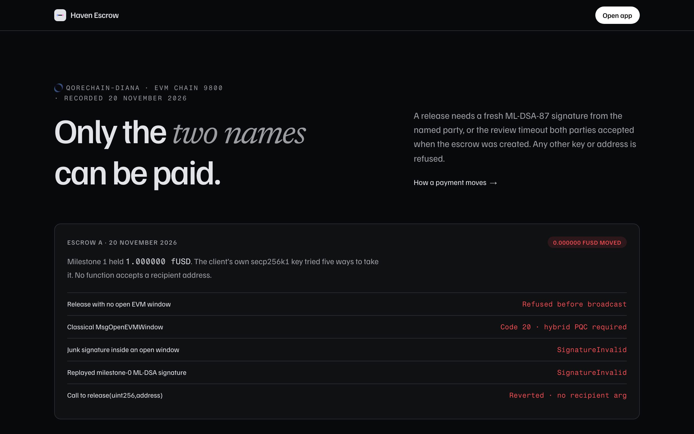
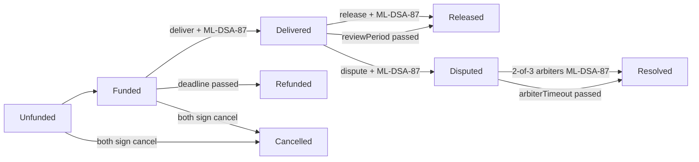

# Haven Escrow

**Pay a freelancer in milestones without a stolen key being able to redirect the money.**

Built for clients and freelancers settling staged work on QoreChain. Once an escrow is created, only the two named addresses can ever receive funds — a stolen secp256k1 key, a rogue relayer, or a lone arbiter cannot redirect or release a cent.

Maya hires a contractor for a two-milestone job worth 2,000 fUSD. Even if an attacker steals Maya's classical wallet key after she funds the escrow, five different release attempts move **0.00 fUSD** — every payout still requires a fresh ML-DSA-87 signature from Maya, a 2-of-3 arbiter split, or the review timeout both accepted at creation.

[Live demo](https://havenesc.vercel.app) · [Watch the film (up to 3 min — not recorded yet)](#built-during-the-hackathon) · [Judge in 5 minutes](#judge-it-in-5-minutes) · [Run locally](#run-locally) · [What works today](#what-works-today)

<p align="center">
  <a href="https://havenesc.vercel.app"></a>
</p>

| What was tested on QoreChain Diana testnet | Measured result |
| --- | --- |
| Client releases milestone 0 after delivery | 1.000000 fUSD paid to the named freelancer |
| Client's own classical secp256k1 key tries five ways to take milestone 1 | **0.000000 fUSD moved** — all five attempts refused |
| Dispute with one arbiter, then two of three signing a 70/30 split | One arbiter refused; two paid 0.700000 fUSD to freelancer and 0.300000 fUSD to client |
| Review timeout (120-second demo window on Escrow B) | Early claim refused; claim after timeout paid 1.000000 fUSD with no new signature |

**Why not an existing escrow or multisig?** Standard EVM escrows authorize payouts with `msg.sender` (secp256k1), so a stolen classical key — or a future quantum break of ECDSA — can release or redirect funds. Haven Escrow ignores `msg.sender` on every sensitive action, requires fresh ML-DSA-87 signatures checked by QoreChain's `pqcVerify` precompile, and has no function that accepts a recipient address.

**What is the biggest risk?** Two colluding arbiters out of three can sign any basis-point split between the two parties and combine their two Shamir shares to decrypt the deliverable; the chain does not judge fairness. In addition, the PQC precompiles (`pqcVerify` and `pqcKeyStatus`) live on QoreChain Diana testnet today, not mainnet.

**How can a judge try it right now?** Open [havenesc.vercel.app/record](https://havenesc.vercel.app/record) and click **Verify all** to check every recorded ML-DSA-87 signature live against QoreChain Diana in the browser with no wallet, or clone the repo and run `npm run evidence` (98 checks, no keys needed).

---

## Contents

1. [The problem](#the-problem)
2. [How it works](#how-it-works)
3. [Hardest technical decision](#hardest-technical-decision)
4. [Judge it in 5 minutes](#judge-it-in-5-minutes)
5. [Where each attack or failure stops](#where-each-attack-or-failure-stops)
6. [Rubric and track mapping](#rubric-and-track-mapping)
7. [What works today](#what-works-today)
8. [Known limits](#known-limits)
9. [Run locally](#run-locally)
10. [Repository map](#repository-map)
11. [Roadmap](#roadmap)
12. [Traction](#traction)
13. [Built during the hackathon](#built-during-the-hackathon)
14. [AI disclosure](#ai-disclosure)
15. [Evidence: testnet addresses](#evidence-testnet-addresses)
16. [Evidence: deploy, fund, and four scenes (20 November 2026)](#evidence-deploy-fund-and-four-scenes-20-november-2026)
17. [Evidence: practice escrow and Courier carry (21 November 2026)](#evidence-practice-escrow-and-courier-carry-21-november-2026)
18. [Evidence: precompile spike results](#evidence-precompile-spike-results)
19. [Evidence: two-stage QCAI audit findings](#evidence-two-stage-qcai-audit-findings)
20. [Evidence: Foundry tests, fuzzing, and invariants](#evidence-foundry-tests-fuzzing-and-invariants)
21. [Evidence: design decisions and cost breakdown](#evidence-design-decisions-and-cost-breakdown)

---

## The problem

Private key compromises accounted for **43.8%** of all cryptocurrency stolen in 2024 ($2.2 billion total), and total stolen crypto surpassed **$3.4 billion** in 2025 ([Chainalysis, Dec 2024](https://www.chainalysis.com/blog/crypto-hacking-stolen-funds-2025/); [Dec 2025](https://www.chainalysis.com/blog/crypto-hacking-stolen-funds-2026/)).

On an ordinary EVM chain, the same secp256k1 key that submits a transaction also authorizes payouts. If a client's or freelancer's classical key is phished, leaked, or eventually broken by a quantum adversary, whoever holds that key can release funds or redirect them to their own address.

Haven Escrow narrows the blast radius to a single rule: **funds can leave an escrow only to the client or the freelancer fixed at creation, and every release requires either a fresh post-quantum ML-DSA-87 signature or a timeout both parties already accepted.**

---

## How it works

An escrow fixes five registered ML-DSA-87 identities at creation: one client, one freelancer, and three arbiters (stored in ascending address order). Every payout function — `release`, `autoRelease`, `refund`, `resolve`, `resolveTimeout`, `cancel`, and `sweep` — pays only the immutable `client` or `freelancer` address. No function takes a recipient parameter.



- **Sender is not the signer.** `msg.sender` is ignored on `deliver`, `release`, `dispute`, `cancel`, and `resolve`. A third-party relayer can pay gas and submit a signed call without holding any authority over the milestone, amount, split, or recipient.
- **Post-quantum verification on chain.** At deployment, `PqAuth.init` calls `pqcKeyStatus` (`0x0000000000000000000000000000000000000a02`) for all five parties and reverts if any key is missing, uses the wrong algorithm, or lacks proof of possession. Every signed action calls `pqcVerify` (`0x0000000000000000000000000000000000000a01`) over the chain ID, escrow address, signer, action, per-party nonce, deadline, and milestone arguments.
- **Timeouts are agreed terms, not new decisions.** `autoRelease` pays the freelancer after `deliveredAt + reviewPeriod` with no new signature. `resolveTimeout` applies `defaultSplitBps` (5000 bps in the demo, remainder to the client) if the arbiters stay silent past `disputedAt + arbiterTimeout`. Boundary seconds belong to the earlier action (`<=` vs. `>`).
- **Encrypted deliverables stay off chain.** The file is encrypted with a random 32-byte AES-256-GCM key, sealed to the client's ML-KEM-1024 key with QoreSeal, and split 2-of-3 with Shamir secret sharing (each share sealed to one arbiter). Only the commitment hash is stored on chain. One arbiter cannot read the file; two together can.

---

## Hardest technical decision

**Keeping the contract minimal and refusing to chase a broken automated audit score.**

The Build Before Q-Day Post-Quantum dApp track requires a two-stage QCAI dashboard audit. Both runs against `src/HavenEscrow.sol` scored **35/100** and flagged `withdraw`, `setFee`, `calculateFee`, `deposit`, `getBalances`, and admin functions — none of which exist anywhere in `src/`. Adding a `withdraw(address)` or admin setter to satisfy the scanner would have directly broken Haven Escrow's core invariant ("no function takes a recipient"). We left the contract unchanged, documented all 12 false positives with exact code and test references below, and kept status-before-signature checks intact even though `cancel` on a `Delivered` milestone returns `WrongStatus` instead of `SignatureInvalid` (because a delivered milestone is already past cancellation).

---

## Judge it in 5 minutes

Everything below runs on QoreChain Diana (`qorechain-diana`, EVM chain ID `9800`) using test fUSD with no real value. If the live testnet RPC is unreachable, `/record` still replays all four recorded scenes and displays `"Could not reach the testnet"` rather than a false pass (see [Known limits](#known-limits)).

1. **Browser replay and live signature check (no wallet, no setup).**
   Open [havenesc.vercel.app/record](https://havenesc.vercel.app/record) and click **Verify all**. The page reads each recorded transaction from `https://evm-testnet.qore.host`, rebuilds the exact ML-DSA-87 message, fetches the signer's key from `pqcKeyStatus`, verifies the 4,627-byte signature in JavaScript via `@qorechain/pqc`, and matches `Released`/`Resolved` and fUSD `Transfer` logs against `client()` and `freelancer()`. It sends no transactions and holds no keys.
2. **Interactive practice desk (browser identities, optional faucet).**
   Open [havenesc.vercel.app/practice](https://havenesc.vercel.app/practice) to generate five fresh local browser identities, fund from the Diana faucet or QoreX, create a live 0.1 fUSD escrow, rehearse the classical-key attack, and run the **Courier delivers, Escrow pays** flow.
3. **One-command hash verification from a clone (no keys).**
   ```bash
   git clone --recurse-submodules https://github.com/datharnu/haven-escrow
   cd haven-escrow
   npm ci
   npm run evidence
   ```
   `npm run evidence` reads `deployments/*.json` and re-checks every recorded hash on `qorechain-diana` via `@qorechain/mcp`. On 23 November 2026 it printed **98 passed, 0 failed** (68 passed after the four scenes on 20 November 2026; 79 passed after the Courier carry on 21 November 2026).
4. **Offline contract, TypeScript, and CBOM tests (no chain, no keys).**
   ```bash
   forge test
   npm run test:ts
   npm run cbom:check
   ```
   `npm run cbom:check` verifies no contract uses `ecrecover` or bypasses the two PQC precompiles, and proves it still catches `ecrecover` against `scripts/fixtures/ecrecover/`.

---

## Where each attack or failure stops

- **Classical key calls `release` with no open EVM window:** refused before broadcast by the QoreChain node (`no open EVM authorisation window`); no transaction hash is created.
- **Classical key calls `MsgOpenEVMWindow` without hybrid PQC signature:** refused by QoreChain with `code 20` (`hybrid PQC signature required`); no window opens.
- **Classical key sends a junk 4,627-byte signature inside a window the real client opened:** reverted on chain with `SignatureInvalid` at `pqcVerify` (`0x…0a01`); 0.000000 fUSD moved.
- **Attacker replays milestone 0's valid ML-DSA-87 signature on milestone 1:** reverted on chain with `SignatureInvalid` (nonce and milestone index are bound in the signed message); 0.000000 fUSD moved.
- **Attacker calls a forged `release(uint256,address)` to redirect funds:** reverts immediately; no function on `HavenEscrow` accepts a recipient address.
- **Rogue relayer alters milestone, amount, split, or payee before submitting:** signature check fails with `SignatureInvalid`; relayer can only submit verbatim or censor.
- **One arbiter tries to settle a dispute alone:** reverted on chain with `TooFew` (2-of-3 quorum required), and one Shamir share fails locally to open the deliverable.
- **Freelancer calls `autoRelease` before the review period ends:** reverted on chain with `TooEarly` (even at the exact boundary second `deliveredAt + reviewPeriod`).
- **All three arbiters stay silent after a dispute:** after `disputedAt + arbiterTimeout`, anyone can call `resolveTimeout` to apply the pre-agreed `defaultSplitBps` (5000 bps).
- **Reentrant token callback during payout:** reverted with `Reentrancy` (`lock` modifier) after `paidToClient`/`paidToFreelancer` is already updated.
- **Attacker tries to `cancel` an already `Delivered` milestone:** reverted with `WrongStatus` before signature verification.

---

## Rubric and track mapping

Built for **Build Before Q-Day** (`https://build.qorechain.io/`), category bounty **Post-Quantum dApp** ("Build an EVM dApp whose sensitive actions receive post-quantum protection"; example projects include *escrow*). Submission deadline: **2 December 2026 at 23:59 UTC**. Jury point weights are not published; every requirement from the Prizes page is mapped below with its honest limit.

| Requirement (exact hackathon wording) | Where Haven Escrow proves it | Honest limit |
| --- | --- | --- |
| **Scoped EVM window** | Create, fund, deliver, release, dispute, resolve, and the classical-key rehearsal each ran inside a scoped EVM window aimed at one contract (or `[A, B]` for funding). `EscrowFactory.create` runs inside a window scoped to `[factory]`. | Deploying `EscrowFactory` itself used an unscoped window because a scoped window cannot create a contract from an EOA. The account's ML-DSA-87 key opens windows; the contract does not. |
| **`pqcVerify`** | `deliver`, `release`, `dispute`, and `cancel` call `PqAuth.authorize`; `resolve` calls `PqQuorum` — both call `pqcVerify` (`0x…0a01`). Constructor calls `pqcKeyStatus` (`0x…0a02`) for all five parties. | The precompile calls live in vendored `haven-pq-kit` v0.1.0 rather than inlined in `HavenEscrow.sol`. `EscrowFactory` runtime code embeds the escrow initcode containing both addresses. |
| **Two-stage QCAI audit** | Both PDFs are committed at `docs/audit/stage-1-2026-11-21.pdf` and `docs/audit/stage-2-2026-11-21.pdf`, with all 12 findings mapped below and in `docs/AUDIT.md`. | Both PDFs score 35/100 on the Ethereum (EVM/Solidity) setting and flag functions not in `src/`. Quantum readiness is `"Not scored"` on this setting (expected per FAQ). |
| **Foundry or Hardhat tests** | `forge test` runs 61 Foundry tests across unit, fuzz (256 runs), invariant (64 runs, 2,560 calls), factory, and byte-vector suites; `npm run test:ts` and `apps/web` Vitest add 39 web unit tests. | Foundry has no QoreChain precompiles, so tests use 4,627-byte keccak mock signatures. Live ML-DSA-87 signatures are proven on Diana testnet and re-checked by `npm run evidence` and `/record`. |
| **Public GitHub repository under MIT or Apache-2.0** | `https://github.com/datharnu/haven-escrow`, Apache-2.0 (`LICENSE`). | Explorer source verification is not available on Diana explorer; compiler settings are in `foundry.toml`. |
| **README and testnet addresses** | This single-file `README.md` contains all addresses, hashes, audit findings, and limits. | Testnet only (`qorechain-diana`, chain ID 9800); fUSD has no monetary value. |
| **Video of up to 3 minutes** | Shot list is ready in `docs/DEMO.md`; featured image is `docs/featured.png`. | **Not recorded yet.** Must be recorded and linked before 2 December 2026. |
| **Built during the event & open-source credits** | First commit `6343063` on 20 November 2026; all kits and libraries credited below. | Shares the two-name immutable-line design shape from the author's earlier project Meter; all contracts here were written fresh for QoreChain. |

---

## What works today

### Observed

- **Deploy and four end-to-end scenes on `qorechain-diana` (20 November 2026):** `EscrowFactory`, Escrow A (two milestones, 1-day review), Escrow B (one milestone, 120-second review), normal release, relayer-submitted delivery, five classical-key refusals, one-arbiter refusal, two-arbiter 70/30 split, early `autoRelease` refusal, and real-wait `autoRelease` payout.
- **Practice escrow on `qorechain-diana` (21 November 2026):** Escrow `0xb0d8Da3B7979120E6877016810D39a792a3Bdf90` created, funded, receipted on `DeliveryReceipts`, delivered, and tested against a zero-signature release (reverted) and classical open (refused before broadcast).
- **Courier carry and escrow payout on `qorechain-diana` (21 November 2026):** Escrow `0x14312980702C0e2c9b85f3478ba9396e59054706` — Courier sealed one file in the browser, the client opened it and recorded the receipt on `DeliveryReceipts`, the freelancer delivered the matching commitment, the page verified `receipt()`, and the client released 100,000 fUSD base units to the stored freelancer.
- **Silent-panel timeout (`resolveTimeout`) on `qorechain-diana` (23 November 2026):** Escrow C (`0xB4410fcC2348212e22c10c1ed302f17225F6F49b`, 0.1 fUSD, 60-second `arbiterTimeout`, 5000 bps default split) — delivered, disputed with client's ML-DSA-87 signature, early `resolveTimeout(0)` refused `TooEarly`, then after a real 60-second wait `resolveTimeout(0)` paid `+50,000` fUSD base units to the client and `+50,000` to the freelancer (Escrow C balance `0`).
- **Automated evidence verification:** `npm run evidence` printed **98 passed, 0 failed** on 23 November 2026 (79 passed on 21 November 2026; 68 passed on 20 November 2026).
- **Live browser verification:** Opened `https://havenesc.vercel.app/record` on 21 November 2026 at 390px and 1440px; **Verify all** verified both ML-DSA-87 signatures on the two-arbiter step, matched 700,000 to freelancer and 300,000 to client, with 0 horizontal overflow and 0 RPC errors.
- **Cryptography and CI checks:** `npm run cbom:check` passed locally on 21 November 2026 (catching the `ecrecover` fixture). GitHub Actions workflow `.github/workflows/test.yml` went green on 21 November 2026 (run `44886746463`, contract + cryptography job); all 39 web unit tests, TypeScript checks, and production build pass locally.

### Built, not observed

- **CI web smoke job:** Added to `.github/workflows/test.yml` after green run `44886746463`; verified locally via `npm run smoke` and `next build`.
- **Escrow B deliverable manifest in the browser UI:** Verified by unit test, not displayed on the timeout scene in `/record`.

### Deliberately absent

- **Mainnet deployment:** `pqcVerify` and `pqcKeyStatus` are on Diana testnet only, not QoreChain mainnet.
- **Admin, owner, fee, or upgrade role:** Excluded by design so no third party can alter terms or redirect funds.
- **On-chain deliverable storage:** Only the commitment hash is stored on chain; ciphertext and sealed envelopes stay off chain.
- **Automated DEX swap for funding:** Pool 2 quoted 178,034 fUSD base units for 6 QOR (below the 3,100,000 needed), so `scripts/fund-client.ts` refuses to swap and uses faucet `MsgConvertCoin` instead.
- **Bytecode-vs-source check in the browser UI:** The **No third name** panel inspects state-changing ABI functions and recorded fUSD transfers; bytecode equivalence is covered by `forge test` and the audit mapping.

---

## Known limits

- **Two colluding arbiters (biggest product risk):** Any two of the three arbiters can sign any split from 0 to 10000 bps and can combine their two Shamir shares to decrypt the deliverable. The contract does not judge whether their split is fair.
- **Testnet-only PQC precompiles (biggest dependency risk):** `pqcVerify` (`0x…0a01`) and `pqcKeyStatus` (`0x…0a02`) exist only on `qorechain-diana` today; moving to mainnet depends on QoreChain enabling those precompiles on mainnet.
- **Testnet RPC availability:** Browser signature checks on `/record` read directly from `https://evm-testnet.qore.host`. If the RPC is down, the page reports `"Could not reach the testnet"` and never fakes a pass.
- **Browser verification scope:** The two steps refused before broadcast have no on-chain hash to read; `autoRelease` has no signature to check; Scene 2 `cancel` reverts `WrongStatus` before checking the signature; `/record` covers only the recorded transactions.
- **No off-chain key or file recovery:** If the ciphertext, AES file key, or arbiter Shamir shares are lost off chain, the contract cannot reconstruct them.
- **Public deal metadata:** Party addresses, milestone amounts, review/arbiter deadlines, and deliverable commitment hashes are public on chain.
- **Demo review timing vs. production:** Escrow B used a 120-second review period so Scene 4 could wait in real time without warping timestamps; real jobs should use long review windows (e.g., 14 days).
- **HavenEscrow does not read `DeliveryReceipts`:** In the Courier carry flow, the browser reads `receipt()` and matches the ciphertext hash before release; the escrow contract itself remains standalone and does not call `DeliveryReceipts`.
- **No explorer source verification:** Diana's explorer does not support verified Solidity source yet; compiler settings (`0.8.28`, optimizer 200 runs, `via_ir`) are in `foundry.toml`.

---

## Run locally

Prerequisites: **Node 22** and **Foundry** (`forge`).

```bash
git clone --recurse-submodules https://github.com/datharnu/haven-escrow
cd haven-escrow
npm ci

# Offline contract, TypeScript, vector, and cryptography checks (no chain, no keys)
forge test
npm run test:ts
npm run typecheck
npm run cbom:check

# Live testnet hash verification (no keys required)
npm run evidence

# Local web app (http://localhost:3020 — replay + browser verify + practice desk)
npm run web
```

Web app checks:

```bash
cd apps/web
npm ci
npm run typecheck
npm run test:unit         # 39 unit tests (vectors, Courier carry, recorded RPC replies)
npm run build             # production Next.js build
npm run smoke             # Playwright smoke at 390px and 1440px (set HAVEN_LIVE_VERIFY=1 for live RPC)
```

Live transaction scripts (`npm run deploy`, `npm run fund-client`, `npm run scene:1`, `npm run rehearse`, `npm run scene:3`, `npm run scene:4`, `npm run scene:5`) read private keys from `~/.haven/<name>.env` (mode `0600`, never committed) and throw `already ran` once their report in `deployments/` has `ok: true`.

---

## Repository map

| Path | Responsibility |
| --- | --- |
| `src/HavenEscrow.sol` | Milestone escrow contract: immutable parties, one ERC-20 token, up to 8 milestones, `PqAuth` / `PqQuorum` checks |
| `src/EscrowFactory.sol` | Deploys fresh `HavenEscrow` instances (`new`, no clones) inside a scoped EVM window |
| `src/EscrowArgs.sol` | Creation struct for escrow terms |
| `src/spike/SpikeTarget.sol` | Precompile spike contract (not a party to any escrow) |
| `src/ts/escrow.ts` | TypeScript ML-DSA-87 signer for deliver, release, dispute, cancel, and resolve |
| `src/ts/deliverable.ts` | Client-side AES-256-GCM encryption, ML-KEM-1024 QoreSeal, and 2-of-3 Shamir key splitting |
| `lib/haven-pq-kit/` | Vendored `haven-pq-kit` v0.1.0 (`PqAuth`, `PqQuorum`, precompile wrappers) |
| `test/` | Foundry unit, fuzz, invariant, factory, and byte-vector tests (61 tests) |
| `test/ts/` | Vitest suite for TypeScript signing, deliverables, and web ABI sync |
| `apps/web/` | Next.js 16 app: `/` (rule & refusals), `/record` (four-scene replay & live browser PQC verifier), `/practice` (browser identities & Courier carry) |
| `scripts/` | Deploy, five testnet scenes, `evidence.ts` (98-check verifier), `cbom.ts` (QoreScan + `ecrecover` check), and `vectors.ts` |
| `deployments/` | Recorded testnet hashes, deliverables (ciphertext + sealed envelopes, no file keys), practice, Courier carry, and Scene 5 `resolveTimeout` JSONs |
| `cards/` | Public ML-KEM-1024 cards for the client and three arbiters |
| `docs/audit/` | Stage 1 and Stage 2 QCAI audit PDFs (`stage-1-2026-11-21.pdf`, `stage-2-2026-11-21.pdf`) |
| `vectors/escrow.json` | Signed-message byte vectors shared by TypeScript and `test/Vectors.t.sol` |

---

## Roadmap

1. **Before 2 December 2026:** Record and publish the ≤3-minute demo film following `docs/DEMO.md`.
2. **Security:** Commission an external Solidity + post-quantum security audit before any real-value use.
3. **Mainnet:** Deploy `EscrowFactory` on QoreChain mainnet once `pqcVerify` and `pqcKeyStatus` are enabled on mainnet, with production review defaults (14 days).

---

## Traction

No external users or customers yet; all runs are our own testnet proofs on `qorechain-diana` — pilot next.

---

## Built during the hackathon

Built during **Build Before Q-Day** (November 2026; deadline 2 December 2026 at 23:59 UTC). First commit: `6343063` on **20 November 2026** (`Add the Apache-2.0 license.`). Licence: **Apache-2.0** (`LICENSE`).

**Credits and open-source libraries:**
- **QoreChain kits:** `@qorechain/sdk` 0.14.0, `@qorechain/pqc` 0.2.3, `@qorechain/qoreseal` 0.1.0, `@qorechain/qoresign` 0.1.0, `@qorechain/mcp` 0.1.1, `@qorechain/qorescan` 0.1.0, `@qorechain/evm` 0.14.0, `@qorechain/wallet-adapter` 0.6.0, `@qorechain/qorex-types` 0.1.0.
- **`haven-pq-kit` v0.1.0:** `https://github.com/datharnu/haven-pq-kit` (submodule commit `9fe7ac289f512e39bce6a2d5e31baeb98195519c`). Its authorization interface follows the public design of [qore-pq-kit](https://github.com/Adityaakr/qore-pq-kit) by Adityaakr (Apache-2.0); the implementation was written for Haven.
- **Haven family:** Courier file-carry and `DeliveryReceipts` integration on escrow `0x14312980702C0e2c9b85f3478ba9396e59054706`. Steward does not call this escrow.
- **Meter:** The rule shape ("a stored payment line with no other recipient") comes from the author's earlier project [Meter](https://github.com/datharnu/Meter); all contracts here were written fresh for QoreChain.
- **Other libraries:** Solidity 0.8.28, Foundry (`forge-std`), viem 2.47.6, `@cosmjs/stargate` 0.39.0, `@noble/ciphers` 2.4.0, `@noble/hashes` 2.4.0, `shamir-secret-sharing` 0.0.4, Next.js 16, React 19, Tailwind CSS 4, Vitest, Playwright, tsx, TypeScript.

---

## AI disclosure

AI coding assistants were used under human direction to write code, tests, web UI, and documentation (commits `4d66bf5`, `a55c534`, and `8fda522` on 21 November 2026 were written in Cursor with Grok 4.7; earlier commits `6343063`–`7280e84` do not record a specific model; later merge resolution and README restructuring used Antigravity).

**Decisions made explicitly by the human:**
- The single invariant: funds leave only to the two named parties, requiring a fresh ML-DSA-87 signature or an accepted timeout.
- Keeping status-before-signature checks (`WrongStatus` on cancelling a delivered milestone) instead of reordering to chase `SignatureInvalid`.
- Refusing to add fake functions (`withdraw`, `admin`, `setFee`) to inflate the 35/100 QCAI score.
- Refusing an unfavorable Pool 2 swap and converting faucet fUSD via `MsgConvertCoin` instead.
- Locking finished scene scripts against re-runs (`already ran`) and deploying/confirming `https://havenesc.vercel.app` on Vercel.

---

## Evidence: testnet addresses

Network: `qorechain-diana` (EVM chain ID `9800`). Explorer for native transactions: `https://explore.qore.network`.

| Role / Contract | Address |
| --- | --- |
| `EscrowFactory` | `0xf30bfc219987E60e849D5cF9e7351b7380eEc09B` |
| Escrow A (two milestones, 1-day review) | `0xE22ff1Cd5d4B9a496C68FeD4946f2cE1dd8954Bd` |
| Escrow B (one milestone, 120-second review) | `0xffd1a9375Ab108Ebe0E439574b5e1D7aA050121A` |
| Escrow C (one milestone, 60-second arbiter timeout, 23 Nov 2026) | `0xB4410fcC2348212e22c10c1ed302f17225F6F49b` |
| Practice Escrow (21 Nov 2026) | `0xb0d8Da3B7979120E6877016810D39a792a3Bdf90` |
| Courier-Carry Escrow (21 Nov 2026) | `0x14312980702C0e2c9b85f3478ba9396e59054706` |
| `DeliveryReceipts` | `0x06b52afc4a151b0efa260e2adcdf2d477632cb56` |
| fUSD (ERC-20, 6 decimals, testnet token) | `0x97143B771D34ddb9130b807b135Ae675A5a963CA` |
| Client (Scenes 1–4) | `qor1hygl6sluskpxj373uyggfev5lzuage4l69zv9q` / `0xB911fD43FC85826947d1E11084e594f8b9D466bf` |
| Freelancer (Scenes 1–4) | `qor1f5x5jggqyg8e05rlaf5xztlwwrlsxamy9j2pxw` / `0x4D0D492100220F97d07fEa68612fee70ff037764` |
| Arbiter 1 | `qor12kfhuvhykw7k9fyukaexldjw07d2m9zuu9un4v` / `0x55937e32E4B3Bd62a49CB7726fB64E7f9AAd945C` |
| Arbiter 2 | `qor1qranaxl35r95mue9qyqqffvhytcvdgjg5agc9e` / `0x00fb3E9Bf1A0cb4DF325010004a59722f0c6a248` |
| Arbiter 3 | `qor1lq0x9xwwcnsv79hat5q56ycg8hhvvyr9ymya83` / `0xf81E6299CeC4E0Cf16Fd5D014D13083DeEc61065` |
| Spike (deployer & relayer, not a party) | `qor143f0ghn8slqguwez73087dvq8lqnuuukqdu9fl` / `0xaC52f45E6787c08E3B22f45e7f35803Fc13e7396` |
| `SpikeTarget` (precompile spike, not an escrow) | `0xe11fe2bb1ad13ab116e0d362b218ef1b2330b1a7` |
| PQC precompiles | `pqcVerify` `0x0000000000000000000000000000000000000a01`, `pqcKeyStatus` `0x0000000000000000000000000000000000000a02` |

Arbiters are stored in strictly ascending address order: Arbiter 2, Arbiter 1, Arbiter 3. Public ML-KEM-1024 cards for the client and three arbiters are in `cards/`.

---

## Evidence: deploy, fund, and four scenes (20 November 2026)

**Plain-sentence summary of key outcomes:**
- On Escrow A milestone 0, the named freelancer received **1,000,000 fUSD base units** (1.000000 fUSD) after client release; Spike (a non-party relayer) then submitted the freelancer's signed delivery for milestone 1.
- Across five classical-key attacks on Escrow A milestone 1, the client's own secp256k1 key moved **0 fUSD base units**; Escrow A's balance remained unchanged at **1,000,000 fUSD base units**.
- On Escrow A milestone 1 dispute, one arbiter was refused (`TooFew`), and two of three arbiters split the milestone 7000 bps: **700,000 fUSD base units** to the freelancer and **300,000 fUSD base units** to the client.
- On Escrow B (120-second review), an early `autoRelease` reverted `TooEarly`; after a real wait past the chain timestamp boundary, `autoRelease` paid **1,000,000 fUSD base units** to the freelancer with no new signature.

### Deploy and fund

Escrow A terms: amounts `1,000,000` and `1,000,000` base units, review `86,400` s, arbiter timeout `259,200` s, `defaultSplitBps` `5000`. Escrow B terms: one milestone of `1,000,000` base units, review `120` s, same timeout and split.

| Step | Hash | Note |
| --- | --- | --- |
| Deploy `EscrowFactory` | `0x3a8fed59201dac842c9c05cae11d72d59d27c8da108964f5206f58b975cac309` | Unscoped window; gas used `2,624,556`; fee `295,263 uqor` (budget `354,316`, cap `5,000,000`) |
| Create Escrow A | `0x9b7288add82823a392fc667819f33a54ff348b8e0df37bfeeef7468c642fab80` | Scoped window `[factory]` |
| Create Escrow B | `0xf4ac289cd80be0c2ac48818b39fddb4eb1118c9ae9bbc805e9111064b99badc2` | Scoped window `[factory]`, 120 s review |
| Convert faucet fUSD (`MsgConvertCoin`) | `9270876CBEF1759C772B7DA3E77C3D5915F6FF6178A68435D5AFFB067C59FBFF` | `2,000,000` base units to A, `1,000,000` to B; no pool swap |
| Fund Escrow A | `0x3030d499ae0f75dd9d22d5aacb1a0dce8540f4c01b92f952a12c7bb7a942cb16` | Scoped window `[A, B]` |
| Fund Escrow B | `0xcdc73b477528d302b38c30830c8e4a35235f174d08eb0b09c195a72481be3929` | Scoped window `[A, B]` |

### Scene 1 — normal release and relayer delivery

| Step | Hash | Result |
| --- | --- | --- |
| Deliver Escrow A milestone 0 | `0xd161906d3089aa0590d8bf031852abf611c103f8ccd6d30403e95a192971d9be` | Milestone 0 `Delivered`; ciphertext in `deployments/deliverables/` (no file key) |
| Release Escrow A milestone 0 | `0x2ef9eac1ad5f785e5ac8f984445b8a19977a01e6482ee1032d176cd4bbf1898a` | `1,000,000` base units to named freelancer |
| Spike submits deliver Escrow A milestone 1 | `0xfaaf878f74237747f26e6994bd45db51ac457f74b0709ca313e15c98fde4a978` | Accepted freelancer's ML-DSA-87 signature from non-party relayer |

### Scene 2 — classical secp256k1 key rehearsal

| Attempt | Hash | Result |
| --- | --- | --- |
| `release(1)` with no open EVM window | *(none — refused before broadcast)* | Node refused: no open EVM authorisation window |
| Classical `MsgOpenEVMWindow` | *(none — refused before broadcast)* | Refused with `code 20` (`hybrid PQC signature required`) |
| `release(1)` with junk signature (inside open window) | `0x23d8d74315ded0ce5aa1cd19c820ffecfaa164bf1bd3ca32f08b2be81699fd9b` | Reverted `SignatureInvalid`; balance unchanged at `1,000,000` |
| `release(1)` replaying milestone-0 ML-DSA signature | `0xed3dcf05267a9ecddb4316fb615c5509e3f3e5df879f00d9e3320be389fd75d9` | Reverted `SignatureInvalid`; balance unchanged at `1,000,000` |
| `cancel(1)` with junk signatures | `0x17fc1668ac8125d0cf5e05fee09875d4fc4578de656baba7ca3673cea86f3b8b` | Reverted `WrongStatus` (status checked before signature) |
| Made-up `release(uint256,address)` (`eth_call` only) | *(read-only call, not broadcast)* | Reverted — no recipient argument exists |

### Scene 3 — dispute and 2-of-3 arbiter split

One arbiter Shamir share was refused locally before any transaction; two shares opened the same plaintext hash locally.

| Step | Hash | Result |
| --- | --- | --- |
| Client disputes Escrow A milestone 1 | `0x7d1d63d40abce0ae8007f7277d262f146958e124a6b86ba173ad48510aa6f463` | Milestone 1 `Disputed` |
| One arbiter calls `resolve` | `0x4c3a8a79bb9bc95b0f29a7c2401917f160200f01df994478f36fb384785f5c42` | Reverted `TooFew` |
| Arbiter 3 submits `resolve(1, 7000)` signed by Arbiters 1 & 2 | `0xd1fd4cac9a1565ee665df65d9d5f239e98ec72ec8fc9d25df7ce8099f079a448` | Freelancer `+700,000`, client `+300,000` fUSD base units |

### Scene 4 — review timeout on Escrow B

| Step | Hash | Result |
| --- | --- | --- |
| Deliver Escrow B milestone 0 | `0x40735fcf9943cd77ff5bd24ab4541ef8f6f92b47107d0fb9e58b803825c8d37f` | Milestone 0 `Delivered` |
| `autoRelease(0)` during 120 s review | `0xd06ae211608d06ce12fa1810d21e946ce667067794569772e4c9ab7174507d87` | Reverted `TooEarly` (real time, no warp) |
| `autoRelease(0)` after chain timestamp passed review | `0xf542a066e48d104fabcde058661775ccb3d3c9c6b538d7b52d97f1bb991cd558` | `1,000,000` base units to freelancer; no new signature |

### Scene 5 — silent-panel timeout (`resolveTimeout`) on Escrow C (23 November 2026)

Escrow C (`0xB4410fcC2348212e22c10c1ed302f17225F6F49b`) held `100,000` fUSD base units with a `60`-second `arbiterTimeout` and `defaultSplitBps = 5000`. After delivery and a client-signed dispute, an early `resolveTimeout(0)` reverted `TooEarly`; after a real 60-second wait with no arbiter signatures, `resolveTimeout(0)` paid **50,000 fUSD base units** to the client and **50,000 fUSD base units** to the freelancer (Escrow C balance `0`). Full window open/close hashes are in `deployments/scene-5-resolve-timeout.json` and verified by `npm run evidence`.

| Step | Hash | Gas used | Result |
| --- | --- | ---: | --- |
| Create Escrow C | `0x4b782365613b534be9fbd224113e02c0121b2601f1a94d93f1edede990f9e7c7` | 1,908,062 | Scoped window `[factory]` |
| Convert `100,000` fUSD (`MsgConvertCoin`) | `AE519F943D68EC95786C58CA88548AA7CD893B42F5651C1E3547D32E9F9FAC6A` | — | Hybrid PQC (`pqc`) |
| Fund Escrow C | `0x628dd9b9d0e8ddd7d16645a2a38a584df91445b2b82b40453291206b48cf56aa` | 80,696 | Milestone 0 `Funded` |
| Deliver Escrow C milestone 0 (freelancer ML-DSA-87 sig) | `0x6b76bcdb7ce222b313eef4b1a062303c881ad2576d9f990e3ebb15869bb1dbd0` | 260,232 | Milestone 0 `Delivered` |
| Dispute Escrow C milestone 0 (client ML-DSA-87 sig) | `0x028aa968481243202945b4cf3fc43022948045eb2bf38582ba6b5c18a6354d04` | 234,726 | Milestone 0 `Disputed` |
| `resolveTimeout(0)` before 60 s `arbiterTimeout` | `0x7ab861cca1f79f2991f843eb93242383580933f9a7e7957662ec5b696d91407a` | — | Reverted `TooEarly` (real time, no warp) |
| `resolveTimeout(0)` after chain timestamp passed timeout | `0xfab97156407bc608077a8c2187f5159a094084e105834b91bdb9188ec34c78e6` | 100,445 | Client `+50,000`, freelancer `+50,000` fUSD base units (`Resolved`) |

---

## Evidence: practice escrow and Courier carry (21 November 2026)

### Practice escrow (`0xb0d8Da3B7979120E6877016810D39a792a3Bdf90`)

Client `0x396D67CF527224aA27b7eb7A9e0173E725eeD036`, Freelancer `0x8c7b839B916554803b3356cE05233B36b73aC3FF`. Milestone 0 ended in status `2` (`Delivered`) holding `100,000` fUSD base units; commitment `0x4eae5484b465291504c20fc1f5c1dc524d9d9c695b557d764f52771992cf5955`. The classical open produced no hash. Courier did not carry this file.

| Step | Hash | Gas used | Result |
| --- | --- | ---: | --- |
| Create escrow | `0xbc084c344f1906b207ff5190a86e439ec97909ec8b2a6501f040a625e577a429` | 1,908,074 | Success (`0x1`) |
| Fund milestone 0 | `0xb403bcc39cff9d259d2340978a780e009e6b3476ef2cc448be17c314228f5eed` | 80,696 | Success (`0x1`) |
| Record receipt (`DeliveryReceipts`) | `0x261bd4952e68c0dbbedaf01ce2ef15b450303ccad54762d284422b986e8f8cc1` | 271,474 | Success (`0x1`) |
| Deliver commitment | `0x32d5407658ef3c5f730ceb18e246339d302b8a4484ca62700d7b0eb75bc19653` | 260,016 | Success (`0x1`) |
| Zero-signature release | `0x4d3bb19b12cee0f3c4deb1f000835901e7e53fc4ba72265805b81d1e3cec24da` | 750,000 | Reverted (`0x0`) |

### Courier carry and release (`0x14312980702C0e2c9b85f3478ba9396e59054706`)

Recorded `2026-11-21T20:56:17Z`. Courier sealed one file in the browser; the client opened it and signed the receipt; `DeliveryReceipts` recorded ciphertext hash `0x7d0cf82a1ba8b2bddbf7b4c2f2cd356c877771494be8ac2181c1cd758fb05b74` (conversation `0x1bd78eaa07a0eb76689a6d8b968f85683bac73ec3e331d1e73cc39e1698e43c1`, counter `0`, `recordedAt` `1795294577`); the freelancer delivered matching commitment `0x007b3887729d4f5609def6085641381946c8d1bb5d6719e3a1c5dbd2aec05689`; the client released **100,000 fUSD base units** to the stored freelancer `0x8c7b839B916554803b3356cE05233B36b73aC3FF` (status `3`, `Released`).

| Step | Hash | PQ status tier |
| --- | --- | --- |
| Create escrow | `0xa657aa638fcb31cfa54cadf19d59da5619241cccd7a20fc4fee762c697a8aa16` | `classical` |
| Convert `100,000` fUSD base units | `0F36FECEFFA1637D4559F6C26F04F89B7543221DC922912D6FA810FB30BB9D52` | `pqc` |
| Fund escrow | `0x1bf8055d76fa8e1058a359ab8b7118e2128ae95f8fcb37e4405348a1804a3799` | `classical` |
| Record receipt (`DeliveryReceipts`) | `0x95a37e72f573830a73e491de42d0f7da7ad33713c80ed35d8626103c90391452` | `classical` |
| Deliver commitment | `0xe98f67c12f88e65c389ac66064a83696ed6cbe0d73da28bea3c7b25779dd4895` | `classical` |
| Release `100,000` fUSD to stored freelancer | `0x602ed45cda12d5c36e89e4f559e6e3ef754e2d50015a3e4eee68ab81c57e22d8` | `classical` |

---

## Evidence: precompile spike results

Ran on 20 November 2026 against `SpikeTarget` (`0xe11fe2bb1ad13ab116e0d362b218ef1b2330b1a7`, not an escrow) at effective gas price `112,500,000,000 wei`.

| Spike | Hash | Gas used | Fee (uqor) | Outcome |
| --- | --- | ---: | ---: | --- |
| S1 Deploy `SpikeTarget` | `0xac057fd48140b66e250f248bb0e4035820d8679e1629bdfd42f964cd333ee358` | 448,701 | 50,479 | Constructor verified `pqcKeyStatus` |
| S2 Relayed ML-DSA ping | `0x836195008261eacffef0b0ffc91dcb44271588178bb790ea649f65b28b60f8cd` | 242,549 | 27,287 | Freelancer submitted client's ML-DSA ping; count became 1 |
| S2 Replay of same ping | `0xd5634f54f8673f85fc30db6be66571e283c8e0c247ffaf3d293cfb87551830ac` | 750,000 | 84,375 | Reverted `SignatureInvalid` |
| S3 Contract creation inside scoped window | `0xa0021315f5db9a2fd875749e20412914563fbadc681ab3da3deada90716dc2e0` | 64,923 | 7,304 | Succeeded; validated `EscrowFactory.create` in `[factory]` window |
| S4 Classical key alone (no window / classical open) | *(none — refused before broadcast)* | — | — | Refused: no open window, then `code 20` (`hybrid PQC signature required`) |

---

## Evidence: two-stage QCAI audit findings

Both reports ran on the same `src/HavenEscrow.sol` using the Ethereum (EVM/Solidity) setting (`Quantum readiness: Not scored`, expected per FAQ). Every finding in both stages named functions not present in `src/`, so no source edits were made between stages and the score remained `35/100`.

| Stage | PDF | Generated | Score | PDF risk level | Findings |
| --- | --- | --- | --- | --- | ---: |
| 1 | `docs/audit/stage-1-2026-11-21.pdf` | 21 November 2026, 09:04 | 35/100 | CRITICAL | 6 |
| 2 | `docs/audit/stage-2-2026-11-21.pdf` | 21 November 2026, 09:22 | 35/100 | HIGH | 6 |

### Stage 1 findings (all 6 false positives)

| Finding | Severity | Auditor location | Verification against `src/HavenEscrow.sol` |
| --- | --- | --- | --- |
| Reentrancy in `withdraw` | CRITICAL | `withdraw` | No `withdraw` exists. Only `_pay` makes an external call; `paidToClient`/`paidToFreelancer` updates first, and every state-changing function has the `lock` modifier (`Reentrancy`). |
| Missing access control on admin functions | HIGH | admin functions | No admin, owner, or upgrade role exists. Permissionless calls (`fund`, `autoRelease`, `refund`, `resolveTimeout`, `sweep`) cannot choose a recipient; signed actions verify ML-DSA-87 via `PqAuth`/`PqQuorum`. |
| Integer overflow in balance calculations | HIGH | balance update functions | Solidity `0.8.28` checked arithmetic reverts on overflow; `held` sums at most 8 milestones. |
| Unchecked external call return values | MEDIUM | transfer functions | `_pay` is the only external call; it reverts `TransferFailed` on failure or non-`true` return data. |
| Front-running in the withdrawal process | MEDIUM | `withdraw` | No withdrawal function exists; payouts require a bound ML-DSA-87 signature or a fixed creation-time timeout split. |
| Unbounded loop in batch operations | LOW | batch processing functions | No batch function exists; constructor caps milestones at `MAX_MILESTONES = 8`. |

### Stage 2 findings (all 6 false positives)

| Finding | Severity | Auditor location | Verification against `src/HavenEscrow.sol` |
| --- | --- | --- | --- |
| Reentrancy in `withdraw` | CRITICAL | `withdraw` | Same as Stage 1: no `withdraw`; `_pay` runs under `lock` after accounting updates. |
| Missing access control on `setFee` | HIGH | `setFee` | No fee and no setter exist; all terms are immutable from the constructor. |
| Integer overflow in `calculateFee` | HIGH | `calculateFee` | No fee calculation exists; `_settle` computes `amount * splitBps / 10000` with `splitBps <= 10000` under Solidity `0.8.28`. |
| Unchecked ETH transfer return value | MEDIUM | `withdraw` | No ETH is transferred (ERC-20 only); `_pay` checks token return data and reverts `TransferFailed`. |
| Front-running in `deposit` | MEDIUM | `deposit` | No `deposit` function exists; `fund()` marks milestones covered by token balance in order and cannot choose a payee. |
| Unbounded loop in `getBalances` | LOW | `getBalances` | No `getBalances` function exists; `held` loops over at most 8 milestones. |

---

## Evidence: Foundry tests, fuzzing, and invariants

Recorded in `.gas-snapshot` (Solidity `0.8.28`, optimizer 200 runs, `via_ir`): **61 Foundry tests total**, **0 failures**.

- **51 unit, factory, and vector tests:** covers creation validation (zero address, same party, party-as-arbiter, >8 milestones, unsorted arbiters, unregistered client/freelancer/arbiter), delivery, release, replay/wrong-escrow/wrong-milestone/expired-deadline refusals, cancellation, refund, sweep, 70/30 resolve, `resolveTimeout`, boundary-second timing, 5 stolen-classical-key tests (client, freelancer, and all 3 arbiters), and byte-for-byte TypeScript vector parity (`VectorsTest`).
- **3 fuzz tests (256 runs each):** `testFuzz_amounts`, `testFuzz_resolveSplit`, `testFuzz_timing`.
- **6 invariant tests (64 runs, depth 40, 2,560 calls each, 0 reverts):** `invariant_conservation`, `invariant_fundsOnlyReachParties`, `invariant_heldCovered`, `invariant_noDoublePayment`, `invariant_releaseNeedsPqOrTimeout`, `invariant_terminalIsFinal`.
- **Web unit tests (`apps/web`):** 39 tests across 9 Vitest files (vectors, recorded RPC replay, Courier carry, No Third Name ABI/transfer checks, practice steps, revert decoding).

---

## Evidence: design decisions and cost breakdown

### Design decisions

| Decision | Why | Date |
| --- | --- | --- |
| 5000 bps `defaultSplitBps` if arbiters stay silent | A full refund or full payout would reward whichever party benefits from a silent panel; rounding remainder goes to the client | 20 Nov 2026 |
| Check milestone status before signature | A `Delivered` milestone cannot be cancelled; leaving `WrongStatus` in place is honest rather than reordering checks to force `SignatureInvalid` | 20 Nov 2026 |
| Deploy with `new`, no clone factory | `HavenEscrow` is `7,876` bytes and `EscrowFactory` is `11,922` bytes (both well under the `24,576` EIP-170 limit) | Measured at build |
| Zero-authority relayer | Spike deploys, funds accounts, and submits deliveries without being a party or arbiter | 20 Nov 2026 |
| No Pool 2 swap under 6 QOR | Pool 2 quoted `178,034` fUSD base units vs. `3,100,000` needed; faucet `MsgConvertCoin` was used instead | 20 Nov 2026 |
| 120 s demo review vs. 1-day product review | Short review on Escrow B lets judges observe real-time `TooEarly` → `autoRelease`; production escrows should use ~14 days | 20 Nov 2026 |

### Cost breakdown (measured on `qorechain-diana`)

Every EVM action on QoreChain requires opening and closing a hybrid-signed EVM window on the Cosmos lane plus EVM execution gas. Haven Escrow charges **0 protocol fee** (`drawFee` / `escrowFee` does not exist).

| Cost item | Measured value | Who pays |
| --- | ---: | --- |
| Native Cosmos tx fee (open window, close window, register, convert) | `180,000 uqor` (gas limit `1,200,000`) | Signing account |
| `EscrowFactory` deploy (one-time) | `2,624,556` gas · `295,263 uqor` (budget cap `5,000,000 uqor`) | Deployer |
| `EscrowFactory.create` (per escrow) | `1,908,074` gas · ~`214,659 uqor` + `360,000 uqor` open/close (cap `3,300,000 uqor`) | Client |
| `fund` (per funding call) | `80,696` gas · ~`9,079 uqor` + `360,000 uqor` open/close (cap `1,320,000 uqor`) | Client or any caller |
| `deliver` (per milestone) | `260,016` gas · ~`29,252 uqor` + `360,000 uqor` open/close | Freelancer or relayer |
| `release` (per milestone) | ~`290,557` gas · ~`32,688 uqor` + `360,000 uqor` open/close | Client or relayer |
| `DeliveryReceipts.record` (optional Courier carry) | `271,474` gas · ~`30,541 uqor` + `360,000 uqor` open/close | Client |
| Window caps in scripts | Deploy `5,000,000 uqor` · Call `2,000,000 uqor` · Resolve `3,000,000 uqor` | Guardrail cap, not spent |

Gas price measured on 20–21 November 2026: `112,500,000,000 wei`.
